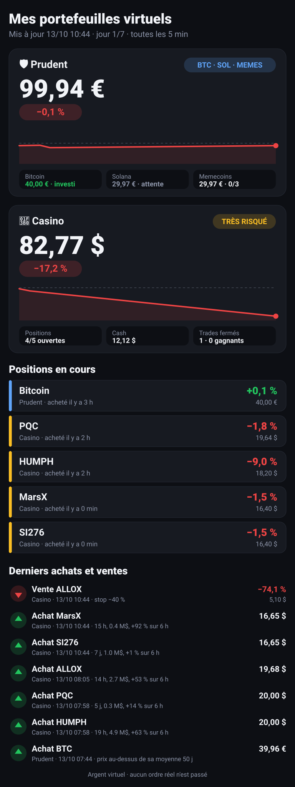

# 📱 Mes portefeuilles virtuels

<b>🛡️ Prudent — ce que le robot regarde</b>

| Token | Note | Cap. | Âge | Décision |
|---|---|---|---|---|
| TROLL | 80/100 | 39.3 M$ | 541 j | ⏸️ pas à un nouveau record |
| BOME | 75/100 | 54.9 M$ | 943 j | ⏸️ pas à un nouveau record |
| arc | 65/100 | 32.1 M$ | 671 j | ⏸️ pas à un nouveau record |
| ANTFUN | 65/100 | 18.8 M$ | 95 j | ⏸️ pas à un nouveau record |
| baton | 62/100 | 14.5 M$ | 34 j | ⏸️ bien plus de vendeurs que d’acheteurs |
| JEANPHIL | 60/100 | 7.1 M$ | 24 j | ⏸️ pas à un nouveau record |

Règles : BTC et SOL investis si le prix est au-dessus de leur moyenne 50 j. Memecoins : > 10 M$, > 14 jours, à un nouveau record ; vente à +50 %, −30 % ou après 14 jours. Prix : BTC 83 795,24 $ · SOL 108,29 $ · 1 € = 1.1196 $

<b>🎰 Casino — ce que le robot regarde</b>

| Token | Cap. | Âge | 1 h | 24 h | Décision |
|---|---|---|---|---|---|
| HIRE | 0.4 M$ | 19 h | +2,6 % | +875,3 % | ⏸️ |
| CRAWLER | 17.9 M$ | 12 h | -10,4 % | +6 668,2 % | ⏸️ |
| LOAD | 7.7 M$ | 14 h | -5,8 % | +3 612,1 % | ⏸️ |
| MarsX | 0.4 M$ | 15 h | +25,5 % | +1 082,0 % | ✅ achat |
| HUMPH | 4.6 M$ | 22 h | +6,9 % | +944,2 % | ✅ achat |
| VEIL | 2.5 M$ | 14 h | +10,1 % | +4 765,0 % | ⏸️ |

Règles : tokens de 6 h à 7 jours, 0.3 à 20 M$, en hausse sur 1 h et de 0 à +200 % sur 6 h, plus d'acheteurs que de vendeurs. 5 positions. Vente à ×2, −40 % ou après 48 h.

<b>📜 Historique complet des ordres</b>

| Date | Portefeuille | Ordre | Prix | Montant | Résultat | Raison |
|---|---|---|---|---|---|---|
| 13/10 10:44 | Casino | 🔴 vente ALLOX | 0,000007086 $ | 5,10 $ | -74,1 % | stop −40 % |
| 13/10 10:44 | Casino | 🟢 achat MarsX | 0,0004081 $ | 16,65 $ |  | 15 h, 0.4 M$, +92 % sur 6 h |
| 13/10 10:44 | Casino | 🟢 achat SI276 | 0,001004 $ | 16,65 $ |  | 7 j, 1.0 M$, +1 % sur 6 h |
| 13/10 08:05 | Casino | 🟢 achat ALLOX | 0,00002651 $ | 19,68 $ |  | 14 h, 2.7 M$, +53 % sur 6 h |
| 13/10 07:58 | Casino | 🟢 achat PQC | 0,0003648 $ | 20,00 $ |  | 5 j, 0.3 M$, +14 % sur 6 h |
| 13/10 07:58 | Casino | 🟢 achat HUMPH | 0,004938 $ | 20,00 $ |  | 19 h, 4.9 M$, +63 % sur 6 h |
| 13/10 07:44 | Prudent (btc) | 🟢 achat BTC | 83 646,67 $ | 39,96 € |  | prix au-dessus de sa moyenne 50 j |

_Argent virtuel uniquement, aucun ordre réel. Mis à jour le 13/10 10:44 (toutes les 5 min environ)._
